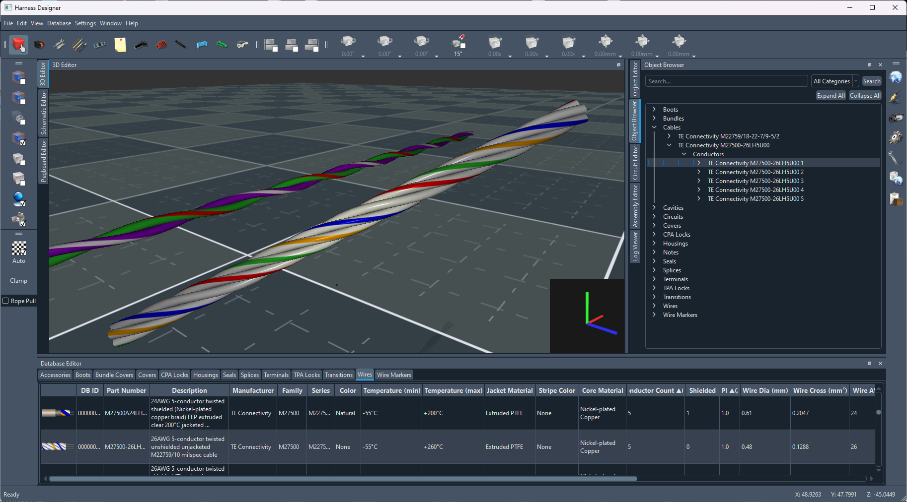
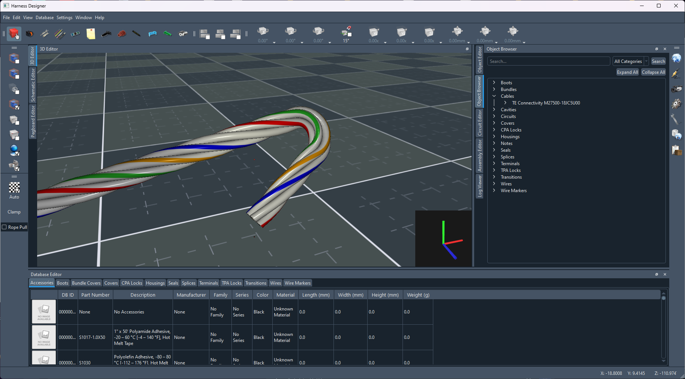
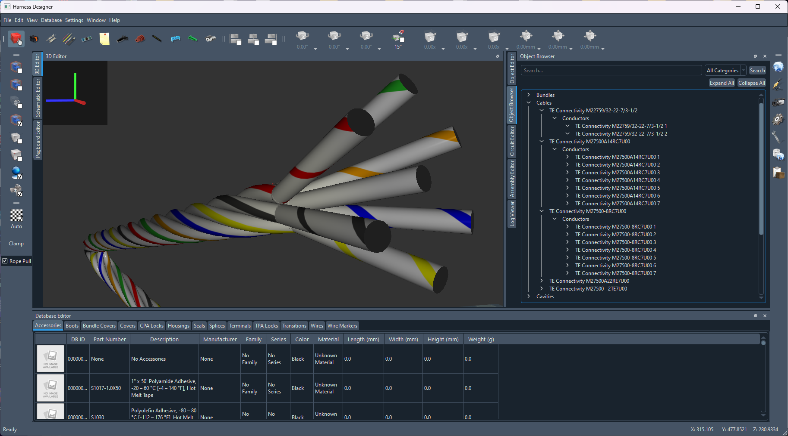
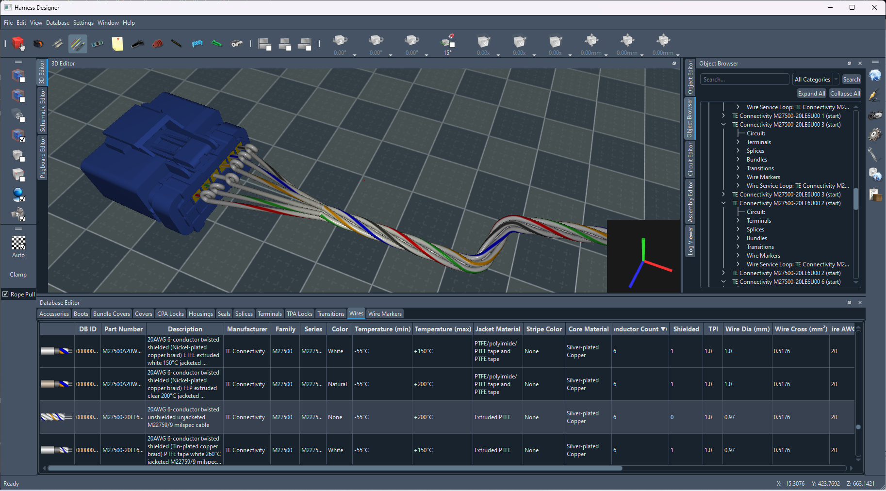
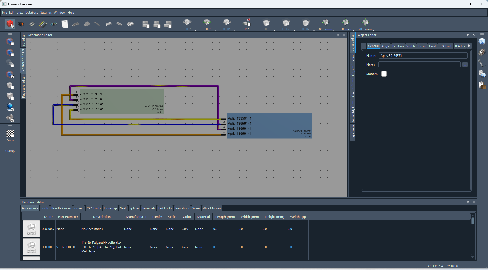
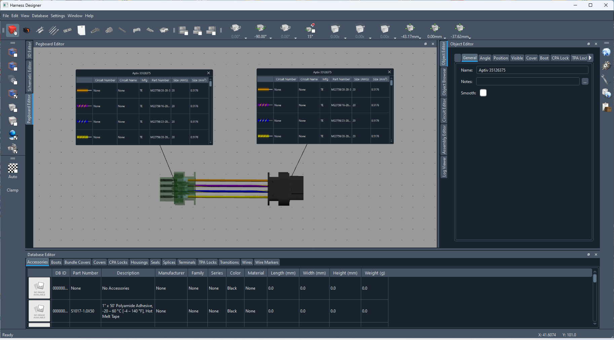
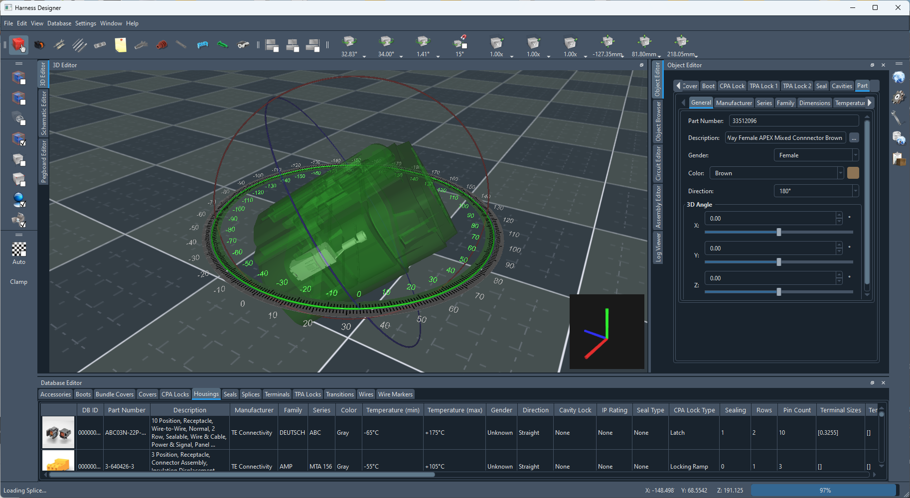
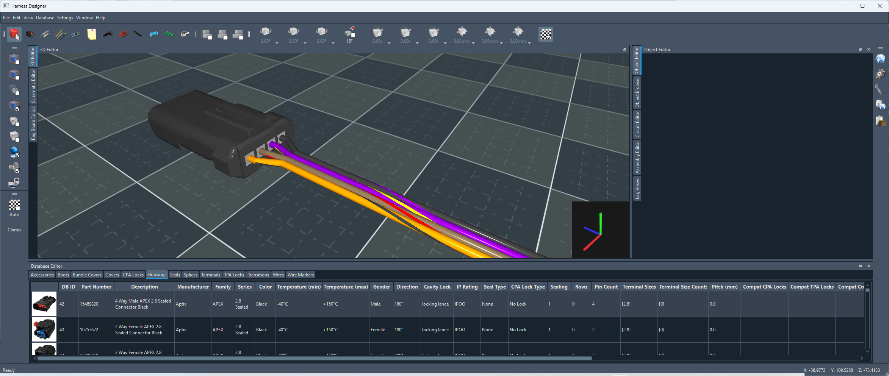
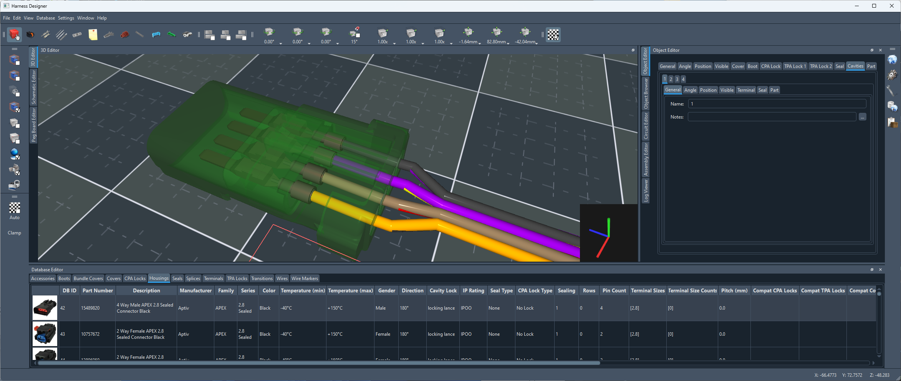

# HarnessDesigner

Wiring harness design software — currently in active development (WIP).

CAD style software for designing wiring harnesses for just about anything
you can think of. From electronics to appliances, automotive, aerospace...

This application is purpose written for designing electricl wiring harnesses it
is not a plugin for another CAD application. It doesn't have all of the features 
seen in a CAD application that can make designing a wiring harness a complicated 
process. The controls have been written specifically for working with the various 
components in a wiring harness and that is what makes it easy to use!

UPDATE:

Latest change is a big one. I reworked the rendering pipeline for wires and bundles.
I liked how the multi-conductor cables worked out and I did some bench marks and
found that the performance was better than how I was rendering a single wire or a bundle.
so not only did the appearance come out better the performance was also better. 
So I made some changes that allow wires and bundles to be rendered in the same manner
as the multi-conductor cables. I also got rid of the sharp angle changes that existed 
from how I was doing the bends.  no they are nice curved bends which looks much better 
and it also lends well to moving the wire/bundle/cable. 

I am getting close to  releasing an alpha test version. Recent things I have added

are the circuits which is complete with a DRT (Design Rules Tester) where the user is 
able to inducate the circuits port source location and voltage and also the load 
locations and what the type the load is (resistive, inductive, etc...). The user also 
has the ability to set what the ambient temperature is going to be where the harness 
is located. They can also optionally add temperature derate tables for the wires. The DRT
will calculate if a circuit exceeds the designed load and or the designed temperature. 
The calculations are done knowing if a wire is bundled or not and if the bundle is 
concentric twisted. These things matter for the temperature and load calculations. 

Concentric twisting has been added. It still needs some polishing done to it. There is no 
automatic layout just yet and that is on the todo list. My game plan is to also allow 
for using AI to handle the concentric layouts as those can be complex depending on the 
scale of the harness being built.

I also added a ray tracing renderer to the application. this is able to render up to 
a 32 mega pixel image that is ultra wide screen. 

Pegboard view printer has been added. You can print out a 1 to 1 of the pegboard view and if 
a large format plotter type of printer is not bing used then each page that is printed off
is going to have alignment marks on it to align the pages on a pegboard for building the harnesses.
The tables that can be shown in the pegboard view for the wire lists and the concentric twisting
are also printed out. This makes it super fast to go from design right into production. 

Rope pulling and slack handling in the pegboard view has been added. What this does is 
if a user clicks and drags a connector once all of the slack has been removed it will pull the 
harness and any other pieces attached to the harness. This mimicks what would happen in real life 
when laying out a harness to create a pegboard. 

Corrected the TE parts that have been added. There was a lot of bad placement and parts 
added that should not have been added. So I cleaned that up.

Added a couple more brands  to the pre loaded parts like Molex.

Added more wiresto the database

Expanded the wire image icons to show shielded wires and twisted wires.

Performance upgrades, lot and lots of them. Setting types for function calls and attributes 
which allows Cython to generate more efficient C code. This handles memory allocation better 
as well as gives the code a little speed boost. 

Realtime python scripting support. This is a nice feature to have if a user wants to write a 
parts scraper. or automate some aspect of building the harness. This still needs quite a bit 
of work but the basic framework is in place. When writing a parts scraper I added an extra 
tool to help out, I built in a fully functional web browser that the raw incoming data can 
be looked at to help with the reverse engineering process for the scrapers. I am also going 
to be attaching the ability to sue AI with this as well and the AI will be able to see that
raw data and write the script needed to scrape the parts information.

---

## Screenshots

I am woeking on adding support for multi conductor cables/wires. This will support 
ribbon cables, twisted cables and multi-conductor cables. This includes jacketed and 
shielded cables as well. The shielding will be able to be terminated. The image below 
is for twisted. One is a twisted pair and the other is a twisted 5 conductor. 

To keep the performance when rendering these types of wires/cables I send a 2d section 
of the cable to the GPU and I have the GPU rotate that slice and render it to produce
the twisted cable. This is a fantastic way of offloading the heavy math to the GPU when 
building this kind of a mesh.

Bends are looking great for the multi conductor cables/wires. I am trying to pay as much 
attention to detail as I can. 

multi conductor cables  can have their individual conductors faned out so they can be 
connected to terminals and splices. 

It's coming along nicely. Here is an example of a multi conductor twisted cable showing 
the cable broken out at the end and connected to a housing. I also added in the wire 
service loops so you can see what that looks like.

Doing some work in the schematic editor, specifically automatic routing of the 
wires when a housing is moved or when a wire is added.  

Doing some work on the pegboard editor... 

I reworked the rotation widget so it looks more professional and so it is a 
more intuitive control. The original control looked almost cartoonish and
it was not easily seen what anfle you were setting. This new control has 2 
protractor style rings where the inner ring rotates with the object and the 
outer ring is fixed. When the rotation widget gets initially shown it is 
3 colored rings one for each axis and you click on the ring (axis) you want to 
rotate. Once you select the axis then the protractor rings will appear. if you 
move the mouse over the tick marks on the outer ring they will light up red. 
Click on the red tick mark and that is the angle that the object will rotate to.
this will align the 0 on the inner ring with the selected tick mark. You cn also 
do a "free" rotate by clicking on the inner ring and dragging, this will 
perform an unbounded rotation. Once again to keep up with the level of detail the  
degree labels that are seen is locked to the camera position so no matter what 
you will always be able to read those labels no matter the camera orientation 
when the rotation is being performed.  

New screen shots that show the level of detail I went into with writing
the code for the application. 

If you look at the connector when it is selected 
you can see the terminals, seals and wires inside of the connector. I even stripped 
off the end of the wire where the crimp is made and it's all positioned like it 
would be when the connector is assembled.

---

## Features

- **Schematic editor** — full schematic design environment
- **3D editor** — real-time OpenGL rendering (see [Performance](#performance))
- **BOM generation**
- **Concentric twisting**
- **3D views of parts** (when available)
- **Rules engine**
- **Circuit numbering and naming**
- **Assembly-aware positioning** — covers, terminals, seals, CPA locks, TPA locks, and boots are parented to their housing. Moving or rotating the housing keeps all attached accessories in the correct relative position. Default accessory positions and starting orientations are configurable, so parts snap into place when added.
- **Database viewer** — multi-stage column sorting with ascending/descending/off per column and a visual sort-order indicator. Supports 70K+ parts without performance issues.
- **Theme manager** — dark and light themes built in; custom themes can be added via Qt style sheets.
- **Multi-seat support** — model downloads and conversions are shared across clients on the same network. Both clients are notified when a download completes and can continue working in the meantime.
- **Cached model format** — converted models are saved as `.hd` files, so subsequent loads require no re-conversion.
- **Pegboard View** — This view is the same thing as what you would do at the production level to build a harness.

---

## System Requirements

| Requirement | Minimum          | Recommended             |
|-------------|------------------|-------------------------|
| CPU cores   | 4 @ 2.0gHz       | 8 @ 3.0gHz              |
| GPU         | OpenGL-capable** | Nvidia Quadro RTX4000** |
| RAM         | 8 GB*            | 32 GB*                  |
| HDD/SSD     | 256GB HDD        | 1 TB SSD                |
| GPU Memory  | 2 GB*            | 8 GB*                   |  

Note: This application needs direct access to the GPU hardware in order to run
      so it will not work in a virtual environment.

*This application is cross platform and will run on Windows, MacOS (ARM) and 
 Linux. On systems thathave shared memory for the GPU take that into account
 when running the application. You will need to have ample shared memory
 between the display adapter and the system in order to run properly.

**OpenGL version 3.3 is the minimum that is required to run. MacOS has deprecated
  the use of OpenGL but it is still available in the OS. It will be removed in 
  the future.

---

## Parts Database

The application ships with a database preloaded with tens of thousands of parts from:

- Aptiv
- Bosch
- TE
- Deutsch
- Molex
- Yazaki

### Available Part Types

- Housings
- Terminal pins
- CPA locks
- TPA locks
- Boots
- Covers
- Seals & plugs
- Transitions
- Shrink tubing
- Splices
- Wires/cables

### Part Attributes

* Wire/cable
  * part number
  * manufacturer ¹
  * description
  * family
  * series
  * color
  * max temp rating
  * image
  * datasheet
  * cad
  * additional colors (stripe colors)
  * core material
  * conductor count
  * shielding
  * turns per inch (for twisted pair)
  * conductor diameter (mm)
  * conductor area (mm² and AWG)
  * outside diameter (mm)
  * weight (grams per meter)
* Housing
  * part number
  * manufacturer ¹
  * description
  * family
  * series
  * color
  * minimum temperature
  * maximum temperature
  * image
  * datasheet
  * cad
  * gender
  * wire exit direction
  * length (mm)
  * width (mm)
  * height (mm)
  * weight (grams)
  * cavity lock type
  * sealing
  * row count
  * cavity count
  * pitch
  * compatible CPAs
  * compatible TPAs
  * compatible covers
  * compatible terminals
  * compatible seals
  * compatible housings (mates to)
  * 2D DXF drawing
  * 3D model (STL or 3MF)
* Terminals
  * part number
  * manufacturer ¹
  * description
  * family
  * series
  * plating type
  * image
  * datasheet
  * cad
  * gender
  * sealing
  * cavity lock type
  * terminal size
  * resistance (mΩ)
  * mating cycles
  * max vibration (g)
  * max current (mA)
  * min AWG
  * max AWG
  * min dia (mm)
  * max dia (mm)
  * min cross (mm²)
  * max cross (mm²)
  * weight (grams)
* Seals
  * part number
  * manufacturer ¹
  * description
  * series
  * color
  * min temperature
  * max temperature
  * image
  * datasheet
  * cad
  * type (single terminal seal, plug, etc.)
  * hardness (Shore)
  * lubricated
  * length
  * outside diameter (mm) (if applicable)
  * inside diameter (mm) (if applicable)
  * minimum wire diameter (mm)
  * maximum wire diameter (mm)
  * weight (grams)
* TPA locks
  * part number
  * manufacturer ¹
  * description
  * family
  * series
  * color
  * image
  * datasheet
  * cad
  * minimum temperature
  * maximum temperature
  * length (mm)
  * width (mm)
  * height (mm)
  * weight (grams)
  * terminal sizes
  * housing cavity locations
* CPA locks
  * part number
  * manufacturer ¹
  * description
  * family
  * series
  * color
  * image
  * datasheet
  * cad
  * minimum temperature
  * maximum temperature
  * length (mm)
  * width (mm)
  * height (mm)
  * weight (grams)
* Covers
  * part number
  * manufacturer ¹
  * description
  * family
  * series
  * color
  * image
  * datasheet
  * cad
  * minimum temperature
  * maximum temperature
  * wire exit direction
  * length (mm)
  * width (mm)
  * height (mm)
  * weight (grams)
* Shrink tubing
  * part number
  * manufacturer ¹
  * description
  * series
  * material
  * color
  * rigidity
  * shrink temperature
  * image
  * datasheet
  * cad
  * minimum temperature
  * maximum temperature
  * minimum diameter (mm)
  * maximum diameter (mm)
  * wall type (single, double, etc.)
  * shrink ratio
  * protections
  * adhesive
  * weight (grams)
* Transitions

¹ Manufacturer field links to manufacturer record.

---

## Roadmap

- [ ] **Assembly editor** — build a fully assembled connector (housing + terminal pins + seals + CPA/TPA locks) as a reusable part. When added to a project the assembly explodes into individual components, letting the user adjust each part independently without affecting other assemblies.
- [x] **Buttons and menus** — toolbar and menu wiring for all existing editor actions.
- [x] **3D editor object manipulation** — add, remove, and manipulate objects (framework is in place; pending buttons/menus).
- [ ] **Schematic editor object manipulation** — same as above for the schematic editor.
- [x] **Object browser** — project tree showing all parts and assemblies (written; needs further testing).
- [x] **Object editor** — collapsible panel showing properties and controls (position, angle, etc.) for the selected object.
- [x] **Refined angle control** — supplement the existing arcball and manual-entry controls with a handle-based drag control. The challenge is presenting Euler angles (X/Y/Z) to the user without hitting gimbal lock during display.

---

## Performance

Stress test scene:

| Primitive | Count |
|-----------|-------|
| Triangles | 10,012,800 |
| Quads | 1,600 |
| Solid lines | 80 |
| Stipple lines | 400 |
| Vertices | 30,044,800 |

480 housings rendered at **172 FPS** in the 3D editor, running in Python.
